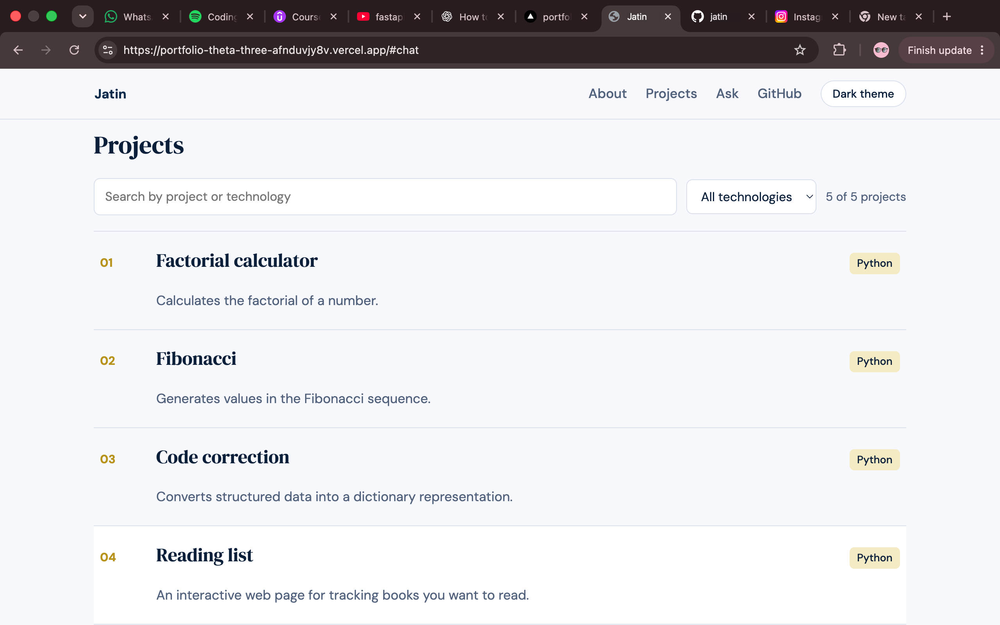
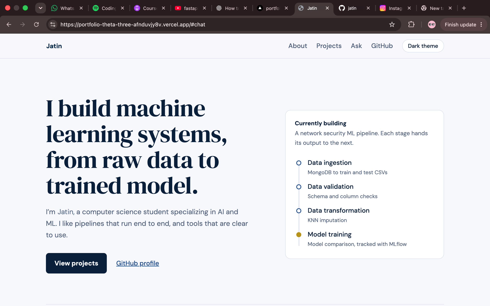

# portfolio

# Personal Portfolio
A responsive portfolio website showcasing my profile, skills, projects and professional links.

## Live Portfolio

https://htmlpreview.github.io/?https://github.com/jatinsamra9525-boop/Portfolio/blob/main/index.html

For a portfolio, use:
* Screenshot 1: Hero/About section
* Screenshot 2: Skills + Projects section
The guide asks for screenshots of the actual working project. 

## Tech Stack

- HTML
- CSS
- JavaScript
- Git
- GitHub
- Vercel

## Features

- Introduces my profile and background
- Displays my skills and projects
- Provides direct links to my GitHub and professional profiles

## Run Locally

1. Clone the repository.
2. Open the project folder.
3. Open index.html in a browser.

## Current Limitations

- The portfolio is a static website.
- Project information must be updated manually.
- It does not currently include a backend or contact form submission service.
